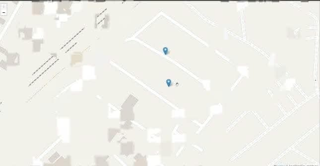
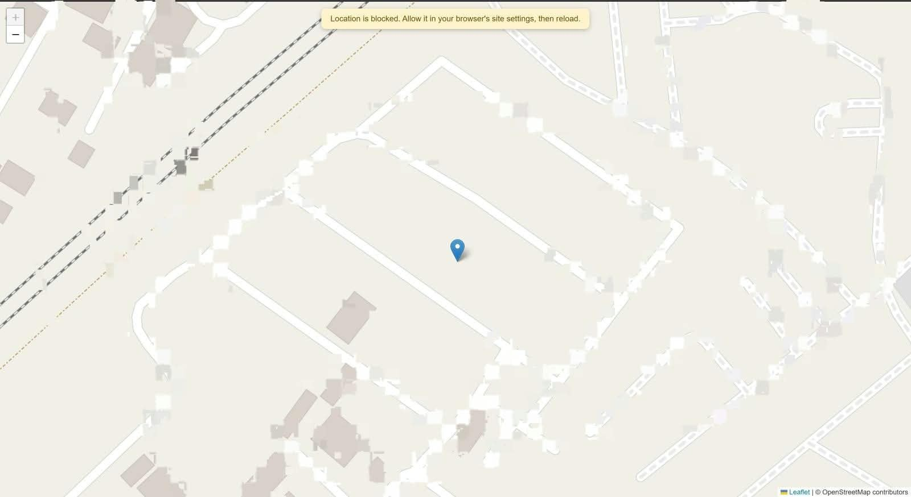
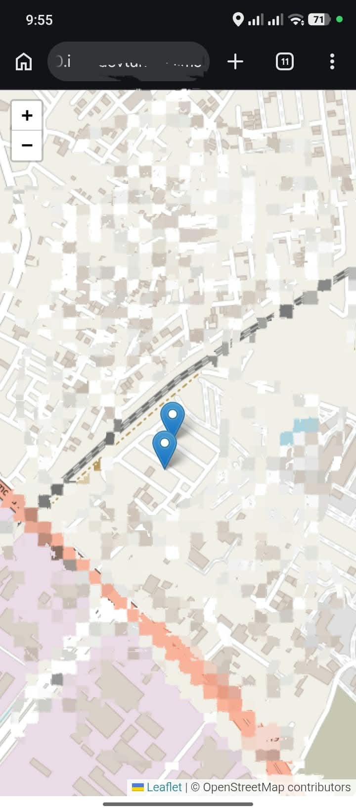

# Real Time Device Tracker

A small web app that shows where you are on a map, and where everyone else who has the page open is, live. Open it on your phone and your laptop, walk around with the phone, and watch its marker move on the laptop screen.

I made this while trying to understand how location and navigation actually work on the web. I knew "Google Maps knows where I am", but I had no idea how a website gets that, or how two devices can see each other move without refreshing. This project is how I figured it out.



## What it does

- Asks the browser for your location and puts a marker on the map
- Sends your position to a server every time it changes
- Shows every connected device on everyone's map, moving in real time
- Removes a marker when that device closes the tab
- Shows people who were already online the moment you join (even if they're standing still)
- Shows a message if location is blocked or unavailable, instead of just a blank map



## How it works (the way I understand it now)

1. **The browser finds out where you are.** `navigator.geolocation.watchPosition()` gives back a latitude and longitude, and keeps calling my function whenever they change. On a phone this comes from GPS. On a laptop it's a guess from Wi-Fi, so it can be a few hundred metres off.
2. **The position goes to the server.** I use Socket.IO instead of normal requests, because it keeps one connection open and the server can push messages to every device without being asked.
3. **The server tells everyone.** It remembers the last position of each connected device and broadcasts every update.
4. **Every browser draws the markers.** Leaflet draws the map and one marker per device, and moves the marker when new coordinates arrive.

Each device is identified by its socket id, which is just a random string Socket.IO gives every connection.

## Built with

- Node.js and Express for the server
- Socket.IO for the real-time part
- EJS for the single page
- Leaflet for the map
- Map tiles from CARTO, using OpenStreetMap data

## Project structure

```
realTimeDeviceTracker/
├── app.js              # server: Express + Socket.IO
├── package.json
├── public/
│   ├── css/style.css   # map size and the status banner
│   └── js/script.js    # browser code: location, map, markers
├── views/
│   └── index.ejs       # the page
└── screenshots/        # images used in this README
```

## Run it yourself

You need Node.js installed.

```bash
git clone https://github.com/Krishna5601-Cpu/realTimeDeviceTracker.git
cd realTimeDeviceTracker
npm install
npm run dev
```

Then open http://localhost:3000 and allow location when the browser asks.

`npm run dev` restarts the server whenever I save a file (it uses nodemon). `npm start` runs it normally.

## Testing it on a phone

This one confused me for a while. If you open `http://192.168.x.x:3000` on your phone, the page loads but **no location is sent**. Browsers only allow location on HTTPS (or on `localhost`), and a Wi-Fi address is neither.

The fix that worked for me was VS Code port forwarding:

1. Start the app with `npm run dev`
2. In VS Code, open the **Ports** tab and click **Forward a Port**
3. Enter `3000`
4. Right-click the port, set **Port Visibility** to **Public**
5. Open the `https://...devtunnels.ms` link on your phone and tap **Allow** for location
6. Open the same link on your laptop


You should now see two markers. Walk around with the phone and the marker moves on the laptop.



Other tunnels like ngrok or Cloudflare Tunnel work too.

## Things that went wrong (and what they taught me)

- **The map was grey.** I had typed `{x},{y}` in the tile URL instead of `{x}/{y}`. One character. Now I know a map is really just a grid of small square images, and the URL tells the server which square you want.
- **Some tiles said "Access blocked".** OpenStreetMap's own servers refused some requests, and my browser (Brave) was hiding the referrer. I fixed it with a referrer meta tag and switched to CARTO tiles. Lesson: free tile servers have rules, and you're expected to follow them.
- **The map kept jumping.** I was re-centering on every update from every user, so with two devices the view flipped back and forth. Now it centers on me only once, so I can still drag the map around.
- **A new device couldn't see the others.** The server only sent positions when someone moved, so a laptop sitting still was invisible. Now the server keeps the last known position of everyone and sends the list when you join.
- **Location worked on localhost but not on my phone.** That's the HTTPS rule above.

## Things I learned

- Latitude and longitude are just two numbers, and a "map" is a lot of work done by a library plus a tile server
- `watchPosition` and `getCurrentPosition` are different: one keeps going, one asks once
- GPS accuracy on a phone and Wi-Fi accuracy on a laptop are very different
- Never trust whatever the client sends. I only take `latitude` and `longitude` on the server so nobody can fake an id and move someone else's marker
- WebSockets feel like magic until you see that it's just an open connection and `emit` / `on`

## A note on privacy

There's no login. Anyone who has the link can see everyone's live location, and positions are only kept in memory (they disappear when the server restarts). Don't share a public tunnel link with people you don't want following you around.

## Ideas for later

- Give each device a name or a colour instead of an anonymous marker
- Draw the path someone has walked
- Rooms, so only people with the same code see each other
- Show distance between two devices
- Deploy it somewhere permanent

## Author

Made by Krishna while learning about maps and navigation.
